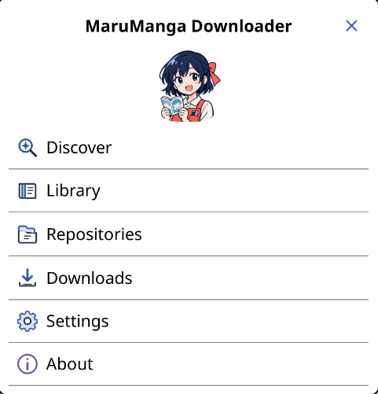
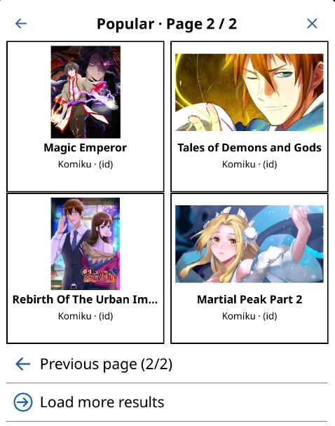
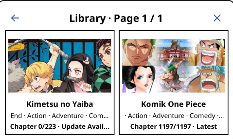
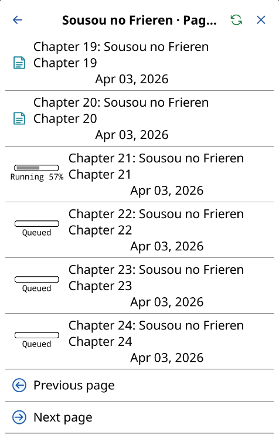

  

# MaruManga Downloader for KOReader

MaruManga Downloader saves manga chapters as one CBZ archive per manga, manages a local library, and checks bookmarked titles for new chapters. It is a native Lua KOReader plugin. Chapter reading uses KOReader's document reader and downloaded files, so reading is available offline.

## Install

1. Download the ZIP from [Latest release](https://github.com/MRHRTZ/MaruManga.koplugin/releases/latest).
2. Extract the `MaruManga.koplugin` folder into KOReader's `plugins` directory. The final path should end in `plugins/MaruManga.koplugin/main.lua` (do not leave an extra nested folder).
3. Restart KOReader.
4. Open **Tools > MaruManga**.

For Android, the plugin directory is normally under KOReader's application data. See [Development documentation](docs/README.md) for locating it and installing with ADB.

## How to use

1. The bundled Maru Manga catalog is installed by default, including compatible sources such as Komiku, MangaRock, MangaMost, Mangago, and WEBTOON. Refresh **Repositories** to check for catalog updates. NSFW sources are installed disabled.
2. Open **Discover > Manage Sources**, check the sources to enable, then choose **Save**. Search, Popular, and Latest updates only offer enabled sources. Other configured repositories can provide additional compatible generic profiles.
3. Open **Discover**, choose Search, Popular, or Latest updates, and open a manga card.
4. On the manga details page choose **Add to Library**.
5. Choose **Download All Chapters** to queue all missing chapters, or open **Chapters** and select a chapter. Choose **Preview** to open that chapter in KOReader without adding it to Downloads or the Library, or choose **Download** to save it. Preview CBZ files are temporary cache and are cleared when another preview starts or MaruManga initializes. Downloaded chapters merge into a single `manga.cbz` for that title. Downloads can be monitored, refreshed, paused, continued, or cancelled from **Downloads**.
6. Open **Library > Browse library**, select a title, then choose **Read Manga** to open its local CBZ in KOReader. The plugin blocks opening while that archive is being modified.
7. Use **Library > Check Updates** to compare bookmarked titles with their source. Already downloaded chapters are excluded from the new chapter count and can be queued for download.

| Main menu | Popular manga |
| --- | --- |
|  |  |
| Library | Downloads |
|  |  |

**Settings** contains Network, Download, Storage, Migrate, and Uninstall. Migrate exports/imports settings, repositories, library/history, download queue, and indexed manga CBZ files in one ZIP. Import restores manga CBZ files to the currently selected Storage folder and replaces the current MaruManga settings. Open a title in **Library > Browse library** and choose **Verify Download** to check that manga's indexed CBZs against saved SHA-256 metadata. Source profiles are checked when installing from a repository. Chapter lists are shown as provided by each source; source language tags identify a catalog's language without filtering its chapters. Network contains timeout, retries, user-agent, DNS and the optional SSL certificate verification override. Download controls concurrent downloads (default 2). Storage shows the active folder (default `marumanga` under KOReader's data directory) and opens KOReader's folder picker; **Restore default folder** returns to that location. Manga CBZ files are written directly into the selected folder with a unique manga name, such as `Tower-of-God--webtoon-12345.cbz`. Covers, cache, source icons, and image staging files are kept under the hidden `.marumanga/` subfolder. Library and queue settings continue to use KOReader's LuaSettings persistence. Uninstall asks separately whether to keep or remove MaruManga's data.

## Update checks

**About > Check for updates** reads the version manifest at [release.json](https://raw.githubusercontent.com/MRHRTZ/MaruManga.koplugin/main/release.json). When a newer release is available, confirm **Update now** to download and install its ZIP, then restart KOReader. The updater accepts HTTPS GitHub release assets, checks the archive structure and plugin version, stages extraction, and restores the prior plugin if activation fails. Keep the release manifest, `_meta.lua`, the archive contents, and the release asset version in sync.

To build the Windows ZIP with KOReader-compatible `/` separators in every ZIP entry, run `powershell -ExecutionPolicy Bypass -File scripts/build-dist.ps1`. The script reads the version from `_meta.lua` and validates the archive paths and required plugin files before reporting success. Do not use a Windows archiver workflow that stores `\` characters inside ZIP entry names: AppStore expects standard slash-separated archive paths.

## Repository sources

Source catalog data is maintained in [maru-manga-repository](https://github.com/MRHRTZ/maru-manga-repository). The plugin bundles reviewed source adapters; repository catalogs do not deliver or execute Lua code. Compatible server-rendered websites can use the shared generic adapter by providing URL patterns and selectors in catalog metadata. Incomplete or unsupported profiles are identified before install. JavaScript-rendered pages, dynamic tokens, authentication, and access restrictions remain unsupported. See [source compatibility](docs/SOURCE_COMPATIBILITY.md) for details. Source language and content tags are shown in repository management.

## Project docs

- [Development guide](docs/README.md)
- [Source compatibility](docs/SOURCE_COMPATIBILITY.md)
- [Attribution and licenses](docs/ATTRIBUTION.md)

See [KOReader's license](LICENSE) for this plugin's license terms.
